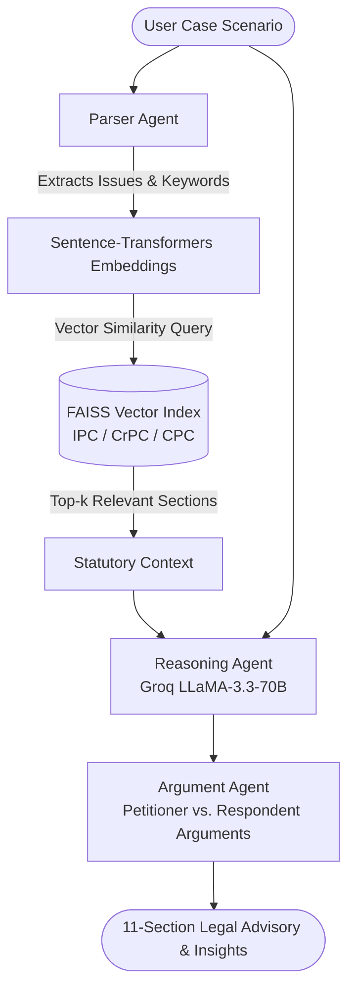

# ⚖️ LexBot — Domain-Specific Indian Legal AI Agent

[](https://www.python.org/)
[](https://streamlit.io/)
[](https://github.com/facebookresearch/faiss)
[](https://groq.com/)
[](LICENSE)

An intelligent, multi-agent legal decision-support system powered by **Retrieval-Augmented Generation (RAG)**. LexBot analyzes plain-English case scenarios, retrieves exact statutory provisions across Indian criminal and civil laws (**IPC**, **CrPC**, and **CPC**), and generates comprehensive, structured legal reasoning reports with zero hallucinations.

---

## 📌 Key Capabilities

- **🔍 Multi-Statute Semantic Search:** Automatically indexes and searches through the **Indian Penal Code (IPC)**, **Code of Criminal Procedure (CrPC)**, and **Civil Procedure Code (CPC)**.
- **🤖 Multi-Agent Orchestration:**
  - **Parser Agent:** Identifies case classification (Civil vs. Criminal), parties (Petitioner / Respondent), primary legal issues, and optimal statutory queries.
  - **Retrieval Engine:** Employs `sentence-transformers` dense embeddings and FAISS similarity indexing for sub-second statutory retrieval.
  - **Reasoning Agent:** Formulates an 11-section structured legal advisory detailing essential legal elements, precedents, bailable/cognizable nature, and procedural workflows.
  - **Argument Agent:** Formulates robust, adversarial legal arguments for both the prosecution and defense.
- **🛡️ Anti-Hallucination Fallback:** Enforces relevance score thresholds to ensure that legal citations strictly correspond to real statutory law.
- **💻 Dual Interface:** Seamlessly switch between a modern **Streamlit Web Dashboard** and an ultra-fast **Terminal CLI**.

---

## 🏗️ System Architecture



---

## 📁 Repository Structure

```text
legal-ai-agent/
├── legal-agent/
│   ├── agents/               # Autonomous agent modules (Parser, Reasoning, Argument)
│   ├── data/                 # Statutory JSON corpora (IPC, CrPC, CPC)
│   ├── llm/                  # Groq API client & optimized legal prompt templates
│   ├── rag/                  # Embeddings, vector store, and multi-query retriever
│   ├── ui/                   # Streamlit web interface (LexBot)
│   ├── vector_store/         # Serialized FAISS index & metadata pickles
│   └── main.py               # Core CLI entry point
├── .env.example              # Template for API keys
├── .gitignore                # Production ignore rules
├── requirements.txt          # Python dependencies
├── run.py                    # Unified root launcher (CLI / Web UI)
└── README.md                 # Project documentation
```

---

## 🚀 Quickstart Guide

### 1. Clone the Repository
```bash
git clone https://github.com/srA12-png/legal-ai-agent.git
cd legal-ai-agent
```

### 2. Set Up Virtual Environment & Dependencies
```bash
python -m venv venv
# On Windows:
.\venv\Scripts\activate
# On Linux/macOS:
source venv/bin/activate

pip install -r requirements.txt
```

### 3. Configure API Key
Create a `.env` file in the root directory (or copy `.env.example`):
```bash
cp .env.example .env
```
Add your free Groq API key:
```env
GROQ_API_KEY=your_actual_groq_api_key_here
```

### 4. Run LexBot

**Launch the Interactive Web UI (Streamlit):**
```bash
python run.py
# or
python run.py --ui
```

**Run via Terminal CLI:**
```bash
python run.py --cli
```

**Analyze a Case Directly from the Command Line:**
```bash
python legal-agent/main.py --case "A entered B's dwelling at midnight without permission and took gold ornaments worth 50,000 INR."
```

---

## ⚖️ Supported Statutes
- **Indian Penal Code (IPC):** Substantive criminal offenses, definitions, and penalties.
- **Code of Criminal Procedure (CrPC):** Arrest, bail conditions, investigation protocols, and trial stages.
- **Civil Procedure Code (CPC):** Civil suit filing, jurisdiction, pleadings, injunctions, and execution of decrees.

---

## 📜 License
Distributed under the **MIT License**. See `LICENSE` for more information.
